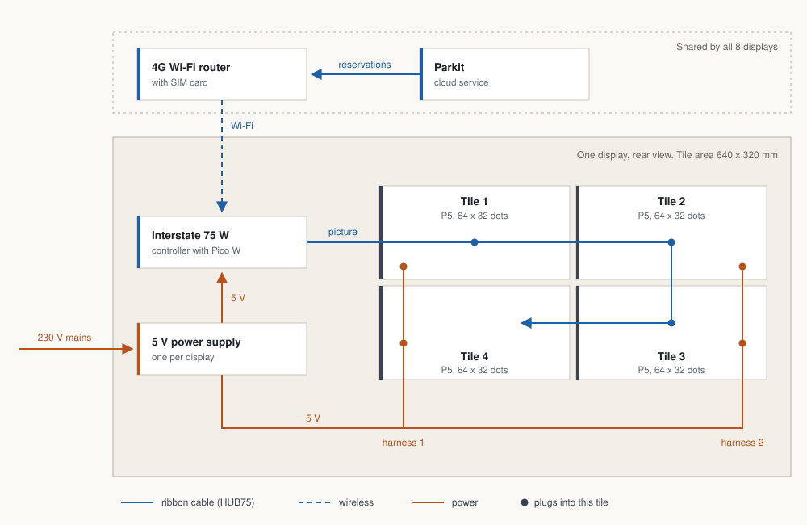

# Display Size and Hardware Spec

**Status:** Proposal, not yet decided. Nothing in here is tested on hardware.

**Summary:** Keep the 128 x 64 pixel picture, but build each bay display from four P5 tiles (2 rows x 2 columns, 640 x 320 mm) instead of two P3 panels (384 x 192 mm). Letters become 1.67 times taller, the existing designs and controller stay. One prototype display must pass the tests in [Open tests](#6-open-tests) before the other seven are ordered.

**Related:** `DISP-01`, `DISP-02`, `DISP-03`, `DISP-05`, `DISP-06`, `HW-01` to `HW-04` in the [LED Integration README](../../README.md). Builds on [LED Options](../research-led/LED%20Options.md) and [Displayed Informations](../research-led/Panel%20output/Displayed%20Informations.md).

## Contents

1. [Problem](#1-problem)
2. [Criteria](#2-criteria)
3. [Out of scope](#3-out-of-scope)
4. [Deliberation](#4-deliberation)
5. [Proposed solution](#5-proposed-solution)
6. [Open tests](#6-open-tests)
7. [Decisions this spec asks for](#7-decisions-this-spec-asks-for)

---

## 1. Problem

The displays hang above the parking bays and are read by a driver in a moving car. The current choice (2 x P3 64x64, see [LED Options](../research-led/LED%20Options.md)) gives a picture of 384 x 192 mm. On it, a licence plate is 42 mm tall and the small text is 18 mm tall. That is enough for someone standing under the display, but small for a driver approaching from several metres away.

The required viewing distance is still an open question (`DISP-01`, [open questions](../../../../project-notes/open-questions.md)). This spec does not answer it by guessing. It gives rules that turn a measured distance into a letter height, and proposes hardware that gives much more margin than the current choice.

Terms used below:

| Term | Meaning |
|---|---|
| Pitch (P3, P4, P5) | Distance between two LEDs in mm. P5 = 5 mm = 2 LEDs per cm. A bigger pitch makes the same picture physically bigger, it does not add pixels. |
| Tile / panel | One LED module with a HUB75 input and output. |
| HUB75 | The ribbon cable interface used by these tiles. It is a common convention, not a formal standard. |

## 2. Criteria

A display setup is acceptable when it meets all of these. C1 to C4 are rules of thumb from sign design; C1 and C2 must be confirmed on site with real people (see [Open tests](#6-open-tests)).

| ID | Criterion | Requirement |
|---|---|---|
| C1 | **Readable distance.** Text that a driver must read is readable at the distance measured on site. Rule: readable distance = letter height x 200. For a quick glance while driving, use letter height x 120. | `DISP-01` |
| C2 | **Minimum letter size.** Must-read text is at least 7 pixels tall. The licence plate is 12 to 14 pixels tall. Text below 7 pixels is only for extra information. | `DISP-01`, `DISP-02` |
| C3 | **Content budget.** One main item (plate or `FREE`) and one secondary item (time). At most 3 lines, about 9 to 12 characters per line. | `DISP-02`, `DISP-04` |
| C4 | **Angle.** The display faces the direction drivers come from. Beyond about 45 degrees to the side, text is not reliable. | `DISP-01`, `DISP-05` |
| C5 | **Far distance works without reading.** From further away than C1 allows, the driver still sees the state (free / reserved) by shape or layout, not by colour alone. | `DISP-06` |
| C6 | **Colours.** Small text is white, yellow or green on black. No blue or pure red for small text. Brightness is capped so the display does not glare in a dark garage. | `DISP-03`, `DISP-06` |
| C7 | **Fits the place.** The bottom edge of the display stays above the vehicle headroom of the garage. | `HW-02`, `DISP-05` |
| C8 | **Keeps what exists.** The 128 x 64 Storybook designs, the font and the Interstate 75 W controller stay usable. | `HW-01` |
| C9 | **Replaceable and available.** Tiles use the HUB75 convention, can be bought from more than one seller, and one broken tile can be swapped alone. | `HW-03`, `HW-04` |
| C10 | **Few parts.** As few different parts and cables per display as possible. | `HW-03` |

How pitch changes the numbers at 128 x 64 pixels:

| Pitch | Picture size | Plate (14 px) | Readable / glance | Small text (6 px) | Readable / glance |
|---|---|---|---|---|---|
| P3 (today) | 384 x 192 mm | 42 mm | 8.4 m / 5.0 m | 18 mm | 3.6 m / 2.2 m |
| P4 | 512 x 256 mm | 56 mm | 11.2 m / 6.7 m | 24 mm | 4.8 m / 2.9 m |
| **P5 (proposed)** | **640 x 320 mm** | **70 mm** | **14.0 m / 8.4 m** | **30 mm** | **6.0 m / 3.6 m** |

These numbers are calculated from the rules in C1, not measured.

## 3. Out of scope

- **What is shown on the display.** States, wording and plate format are defined in [LED Display Use Cases](../../led-display-use-cases.md) and [Panel output](../research-led/Panel%20output/). This spec only sets the size limits in C2 and C3.
- **Choice of 4G router, SIM plan and data volume** (`HW-07` to `HW-09`).
- **The Parkit API** for the displays (endpoint, payload, API key handling).
- **Mounting method, cable routes and mains wiring.** These need Facility Management approval (`DEC-001`). Mains wiring must be done by a qualified person.
- **Displays at the garage entrance.** This spec covers the 8 bay displays only.
- **Cost over 10 years.** Only first purchase prices are listed.

The question "is there a Raspberry Pi orchestrator?" is not decided here either, but the proposed hardware has to work with both answers. See [4.3](#43-orchestrator-or-not).

## 4. Deliberation

### 4.1 Which size

| Option | Pixels | Size | Verdict |
|---|---|---|---|
| A. 2 x P3 64x64 (today) | 128 x 64 | 384 x 192 mm | Baseline. Small text fails C1 beyond about 3.6 m. |
| B. 2 x P4 64x64 | 128 x 64 | 512 x 256 mm | Good size, only 2 tiles. Found at one seller only, so it fails C9. |
| **C. 4 x P5 64x32, 2 x 2** | 128 x 64 | 640 x 320 mm | **Proposed.** Largest letters at the same pixel count, tile is sold by many makers. Needs 4 tiles and a 2 x 2 mapping in the firmware. |
| D. 2 x P5 64x32 side by side | 128 x 32 | 640 x 160 mm | Only 2 tiles, but only 2 lines of text. Existing designs must be redone, fails C8. |
| E. 4 x P4 64x64, 2 x 2 | 128 x 128 | 512 x 512 mm | 4 times the LEDs to drive and power, designs must be redone, tall (C7). |
| F. P2.5 128x64 tiles | 256 x 128 | 640 x 320 mm | Sharper, but 4 times the pixels. Probably too much for the Interstate 75 W. Fails C8. |
| G. P8 / P10 outdoor tiles | 64 x 32 or less | up to 1024 x 512 mm | Too coarse for a plate plus a time line, or far bigger than the bay needs. |

Why C over B: both keep the picture, the designs and the controller. C gives 25 % taller letters and uses the most common HUB75 tile format. B has fewer parts but depends on a single seller.

### 4.2 Hobby tiles or a commercial sign

| Option | Open? | Verdict |
|---|---|---|
| HUB75 tiles + own controller | Yes. Own firmware, tiles from any maker. | **Proposed.** Fits the goal that the apprentices build and understand the system. |
| Commercial LED controller cards (Huidu, Novastar, Colorlight) | Mostly closed. Content is set with the vendor's software. | Rejected for now. Would replace the Interstate 75 W and the existing code. |
| Finished LED sign bars or parking guidance signs | Closed. | Rejected. Cannot show Parkit data without a vendor interface. |

Correction to the earlier research: the Advatek PixLite and Falcon F16 controllers in the Option 3 diagram drive addressable pixel strips, not HUB75 tiles. They do not fit these panels. (From general knowledge, not checked against a datasheet.)

### 4.3 Orchestrator or not

The fewest parts are reached when every controller asks Parkit directly over Wi-Fi and the only shared device is a 4G Wi-Fi router. A Raspberry Pi orchestrator then becomes optional.

| | Controllers ask Parkit directly | Raspberry Pi orchestrator in between |
|---|---|---|
| Shared parts | 1 (4G Wi-Fi router) | 1 (Pi 4 with 4G HAT as access point) or 2 (Pi + router) |
| API key stored on | 8 controllers | 1 Pi |
| Controller software | Wi-Fi, HTTPS, JSON, drawing | Wi-Fi, simple local request, drawing |
| If Parkit is unreachable | Each controller shows the safe status (`REL-07`) | Pi can cache and decide for all |
| Risk | HTTPS on a Pico W is tight on memory | One more device that can fail |

This is a pending decision in [decisions.md](../../../../project-notes/decisions.md). The display hardware in this spec is the same in both cases. Recommendation: test the direct way first on one existing Interstate 75 W. If it is not reliable, add the Pi.

## 5. Proposed solution

Each bay display is four P5 64x32 tiles in 2 rows x 2 columns on one backplate, driven by one Interstate 75 W and one 5 V power supply.

*The controller asks Parkit for its bay's reservations through the shared router, then passes the picture along one chain of ribbon cables: tile 1, 2, 3, 4. Tiles 3 and 4 are mounted upside down so the ribbons stay short. One 5 V supply feeds the controller and, through two harnesses, the four tiles. All parts sit on one backplate.*

### 5.1 Parts per display

| Qty | Part | Product | Note |
|---|---|---|---|
| 4 | P5 LED tile, 320 x 160 mm, 64 x 32 pixels, HUB75 | Waveshare RGB-Matrix-P5-64x32 or an equal tile | All 4 tiles of one display, better all 36, from the same batch so colours match |
| 1 | Controller | Pimoroni Interstate 75 W | The existing boards (Pico W) are reused if test T1 passes |
| 1 | 5 V power supply | Mean Well LRS-50-5 (5 V, 10 A) | Size is an estimate, see test T3. Has open mains terminals: needs a cover and qualified wiring |
| 1 | Backplate, about 660 x 340 mm | Custom | Holds tiles flush, carries controller and supply |
| 4 | HUB75 ribbon cable | Comes with the tiles | Controller to tile 1, then tile to tile |
| 2 | Tile power harness | Comes with the tiles | Each feeds two tiles |

Small parts: screws for the tiles (thread size to be checked on the first tile), Wago 221 connectors, 1.5 mm² wire.

For 8 bays: 32 tiles plus 4 spares, 8 controllers, 8 power supplies, 8 backplates. Shared by all displays: one 4G Wi-Fi router with SIM card (`DEC-005`).

### 5.2 Where to buy (checked 10 November 2026)

| Source | Item | Price | Finding |
|---|---|---|---|
| AliExpress, item 1005011661208809, variant "64x32 - P5mm" | Waveshare RGB-Matrix-P5-64x32 with ribbon, power cable, screws | CHF 22.39 incl. VAT | Usable for the prototype. Listing text is inconsistent (wiki link and size guide refer to P4), seller has 1 sale. Measure 320 x 160 mm on arrival. |
| BerryBase.ch | Adafruit 64x32, 5 mm pitch (ADA2277) | CHF 49.90 | 2 in stock. Product seems to be at end of life. |
| Waveshare shop | RGB-Matrix-P5-64x32 (SKU 25848) | USD 21.99 list | Stock could not be confirmed, site did not load. |

Order in two steps: 4 tiles for one prototype, then the remaining 32 in one batch after the tests pass.

**Prototype order placed on 10 November 2026:** 4 tiles from the AliExpress listing above. Tiles EUR 96.96 (EUR 24.24 each), shipping EUR 50.17, total EUR 147.13. That is EUR 36.78 per tile delivered, before any import charges. Shipping is a third of the cost, so for the full order compare delivered prices, not list prices, and ask the seller for a combined shipping quote.

### 5.3 Shopping list

Prices and stock checked on 10 November 2026.

**Step 1: prototype, one display on the bench**

| Qty | Item | Source | Price | Status |
|---|---|---|---|---|
| 4 | P5 tile 64x32, 320 x 160 mm, with ribbon and power cable | AliExpress, item 1005011661208809 | EUR 147.13 total incl. shipping | Ordered 10 November 2026 |
| 1 | Pimoroni Interstate 75 W, RP2350A (PIM727) | BerryBase.ch | CHF 22.90 | Ordered 10 November 2026 |
| 1 | Test lead 1 mm², 2 x 4 mm banana plug, 50 cm, red (T1325526) | BerryBase.ch | CHF 1.65 | Ordered 10 November 2026 |
| 1 | Test lead 1 mm², 2 x 4 mm banana plug, 50 cm, black (T1325525) | BerryBase.ch | CHF 1.65 | Ordered 10 November 2026 |
| 4 | Wago 221-415 connector, 5-way (2 needed, 2 spare) | BerryBase.ch | from CHF 0.75 each | Ordered 10 November 2026 |
| 1 | Interstate 75 W with Pico W (RP2040) | In hand | - | Stays on the P3 panels for comparison |
| 1 | Voltcraft ESP-3010 lab supply | In hand (`DEC-008`) | - | Powers the tiles on the bench. Set 5.0 V before connecting |

The BerryBase.ch order came to CHF 38.70 in total: CHF 29.20 for the items plus CHF 9.50 shipping, VAT included.

Bench wiring: cut one plug off each test lead and clamp the open end into a Wago. Clamp the four tile power cables into the same Wago (one Wago for plus, one for minus). The controller is powered by USB-C from the laptop.

**Step 2: full build, 8 displays. Order only after the tests in section 6 pass.**

| Needed | In hand after step 1 | To buy | Item | Note |
|---|---|---|---|---|
| 36 | 4 | 32 | P5 tile 64x32 (32 mounted + 4 spare) | One batch, same seller as the prototype if T4 passed |
| 8 | 1 | 7 | Interstate 75 W, RP2350A | The older Pico W board becomes the spare. All 8 displays then run the same firmware |
| 8 | 0 | 8 | 5 V power supply | Model and size after T3 |
| 8 | 0 | 8 | Backplate, about 660 x 340 mm | Custom |
| 20 | 2 spare | 18 | Wago 221-415 (2 per display + spares) | |
| 20 m + 20 m | 0 | 20 m + 20 m | Wire 1.5 mm², red and black | Estimate, about 2 m of each per display. Not sold by BerryBase.ch |
| 1 | 0 | 1 | 4G Wi-Fi router with SIM | Chosen elsewhere, see section 3 |

Ribbon cables, tile power cables and screws come with the tiles.

### 5.4 How the proposal meets the criteria

| Criterion | Result |
|---|---|
| C1, C2 | Plate 70 mm, must-read text from 35 mm (7 px). Calculated, to be confirmed by T5. |
| C3, C8 | Same 128 x 64 picture, designs and font unchanged. |
| C4 to C6 | Not changed by the hardware. To be handled in the display designs and at mounting. |
| C7 | The display is 320 mm tall instead of 192 mm. Open, see T6. |
| C9 | P5 64x32 HUB75 tiles are sold by several makers. |
| C10 | 7 parts per display plus cables. 2 more tiles than today. |

## 6. Open tests

Nothing below is proven. T1 and T2 can start today with the existing hardware.

| ID | Test | Passes when | Hardware needed |
|---|---|---|---|
| T1 | Interstate 75 W (Pico W) fetches the reservation over HTTPS from the test API and draws it | 24 hours of polling every 30 s without crash or memory error | Existing |
| T2 | Simulate the bigger display: look at the existing P3 display from 6 m. This looks like the P5 display from 10 m. From 7.5 m it looks like P4 from 10 m. | 5 people read plate and time line correctly | Existing |
| T3 | Power: measure the current of 4 tiles at full white and at the planned brightness with the Voltcraft lab supply (`DEC-008`) | Measured peak, plus 30 % reserve, is below the rating of the chosen supply. Tiles are rated up to 4 A each (16 A worst case); the estimate is that 10 A is enough with a brightness cap | Prototype tiles |
| T4 | 2 x 2 mapping: four chained 64x32 tiles are a 256 x 32 strip for the controller, with tiles 3 and 4 upside down. The firmware must fold this into 128 x 64 | A test picture is correct across all 4 tiles, no flicker, no wrong colours (also checks that the tile's driver chip works with the controller) | Prototype tiles |
| T5 | Readability on site at the measured distance, light on and off, straight and from 45 degrees | 5 people read plate and time line; state is clear from further away without reading | Prototype display |
| T6 | Headroom: measure ceiling height and required vehicle clearance at each bay | 320 mm display plus mount fits above the clearance at all 8 bays | Tape measure |
| T7 | Seam: the joint between top and bottom row runs through pixel row 32 | No visible gap or offset in text that crosses the joint, or designs avoid it | Prototype display |
| T8 | Wi-Fi and 4G reception at the display positions (`HW-05`) | All 8 positions reach the router; router reaches Parkit | Router |

If T4 fails, fall back to option D (2 tiles side by side, 128 x 32) or option B (2 x P4). If T6 fails, the same two fallbacks apply.

## 7. Decisions this spec asks for

1. Accept criteria C1 to C10 as the way to judge display hardware.
2. Buy 4 P5 tiles and one power supply for a prototype. (Tiles, one controller and bench connectors ordered on 10 November 2026, power supply still open.)
3. Decide on the full order (32 tiles + spares) only after T1 to T7 are done.
4. Record the result in [decisions.md](../../../../project-notes/decisions.md) and close the related entries in [open-questions.md](../../../../project-notes/open-questions.md).
