# PARKIT Orchestrator — Installation and Usage

This guide explains how the PARKIT Orchestrator was installed, how to connect to it, and how to run code. The Raspberry Pi runs without a screen, keyboard, or desktop interface.

## 1. System details

| Item | Value |
|---|---|
| Hostname | `PARKIT-Orchestrator` |
| Local network address | `parkit-orchestrator.local` |
| Username | `parkit-orchestrator` |
| Password | Stored in the team password manager; **not in GitHub** |
| Operating system | Raspberry Pi OS Lite (64-bit), Debian 13 (Trixie) |
| CPU architecture | `aarch64` |
| Memory | 8 GB (about 7.6 GiB usable) |
| Python | 3.13.5 |
| Remote access | SSH with password authentication |
| Time zone | `Europe/Zurich` |
| Keyboard | Swiss (`ch`) |

> **Check the hardware model:** The terminal screenshot shows **Raspberry Pi 4 Model B Rev 1.5, 8 GB**. The device was first described as a Raspberry Pi 5. The actual model should be checked on the device or with `cat /proc/device-tree/model`.

## 2. What you need

- Raspberry Pi, power supply, and microSD card (32 GB used here)
- SD card reader and a Mac or another computer
- Raspberry Pi Imager (version 2.0.12 used here)
- Local Wi-Fi or a phone hotspot

Download Raspberry Pi Imager: https://www.raspberrypi.com/software/

## 3. Install the operating system

### Step 1 — Select the OS

Open Raspberry Pi Imager. Select the **actual** Raspberry Pi model. Choose **Raspberry Pi OS Lite (64-bit)**. Lite does not have a desktop interface, so it uses fewer resources.

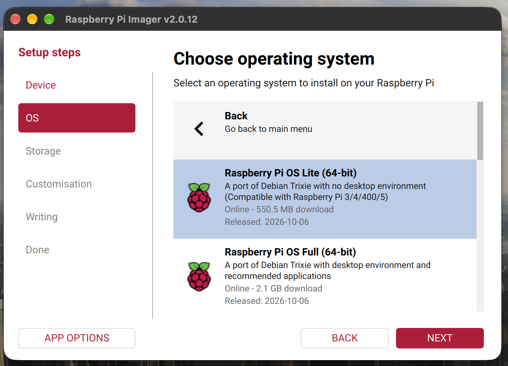

### Step 2 — Select the SD card

Select the microSD card. In this setup it appeared as **Generic USB SD Reader Media — 31.9 GB**.

> **Warning:** Writing the OS will erase the selected card.

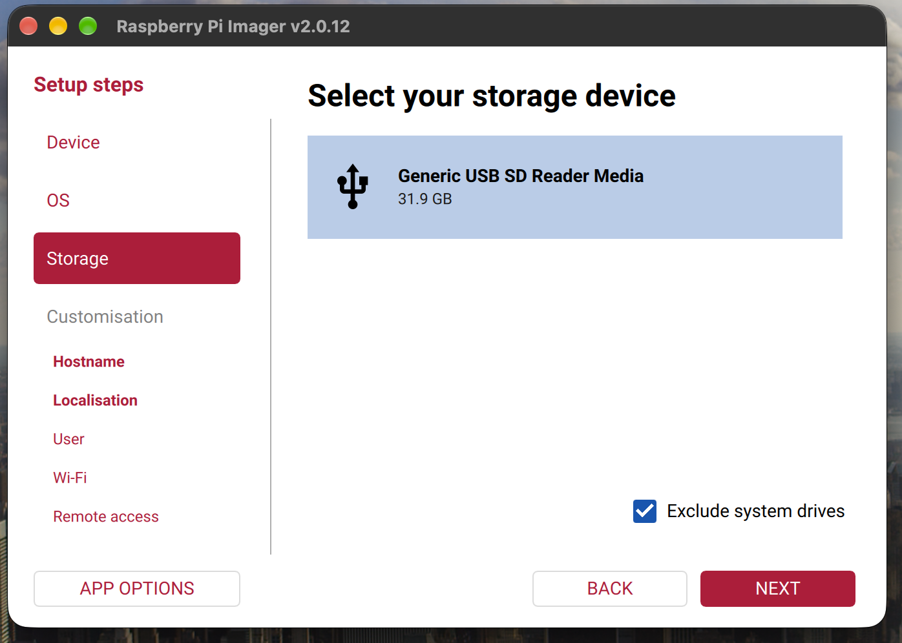

### Step 3 — Set the hostname

In **Customisation**, enter `PARKIT-Orchestrator` as the hostname.

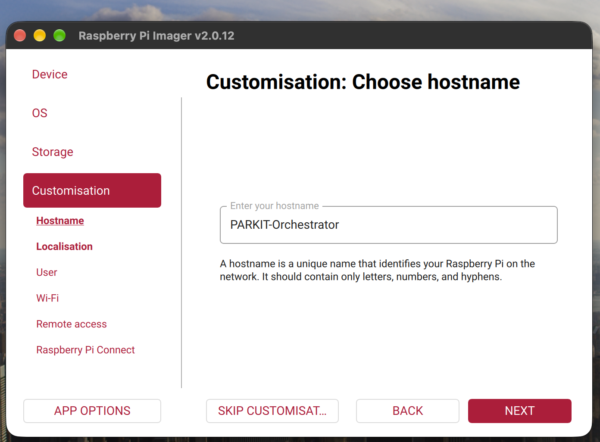

### Step 4 — Set the region

Use **Bern, Switzerland**, time zone **Europe/Zurich**, and keyboard layout **ch**.

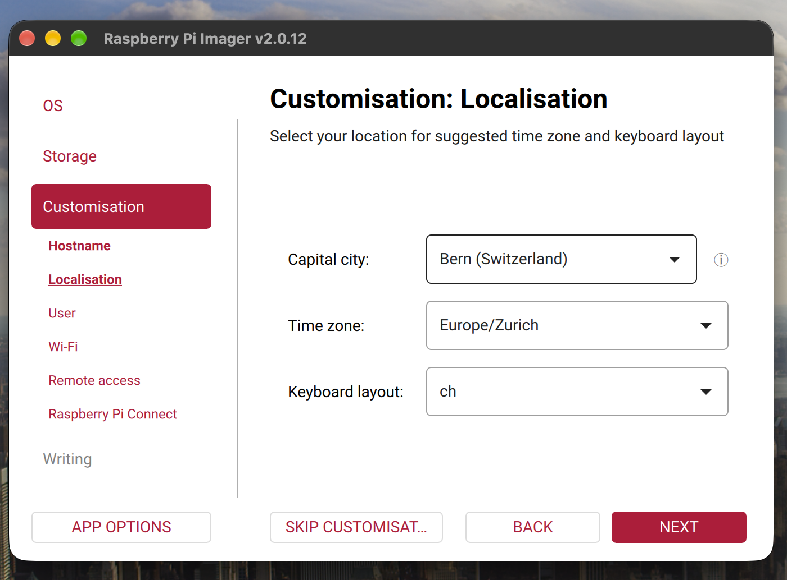

### Step 5 — Create the user

Set the username to `parkit-orchestrator`. Create a strong password and save it in the team password manager.

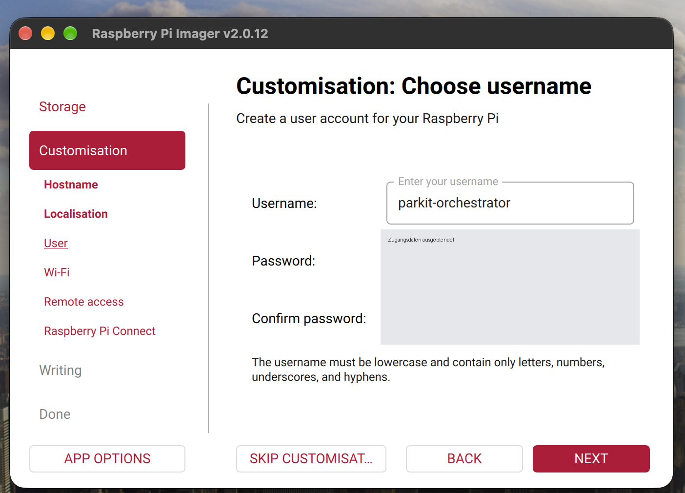

### Step 6 — Set up Wi-Fi

Choose **Secure Network** and enter the exact Wi-Fi name (SSID) and password. During the first setup, an iPhone hotspot was used. Leave **Hidden SSID** off unless the network is hidden.

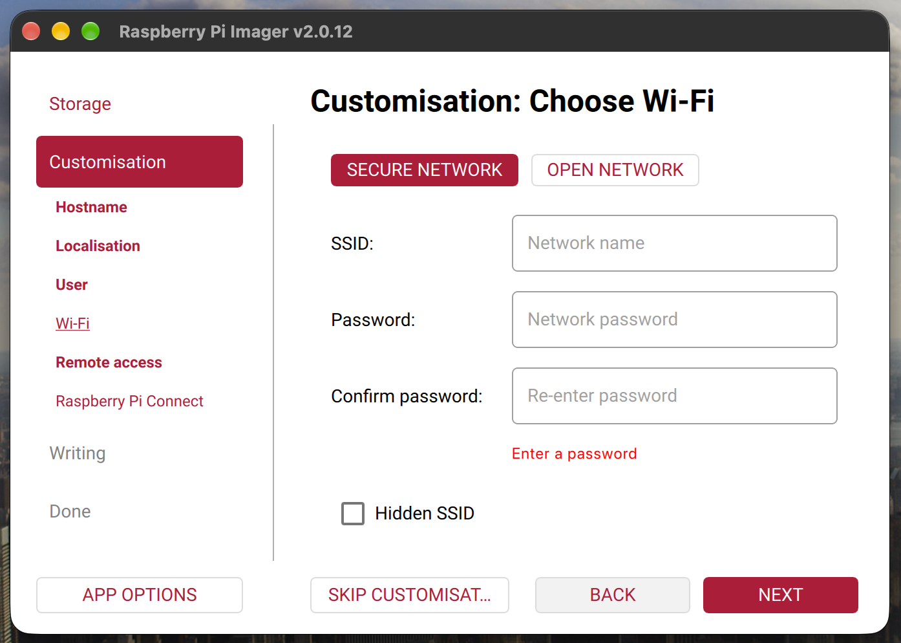

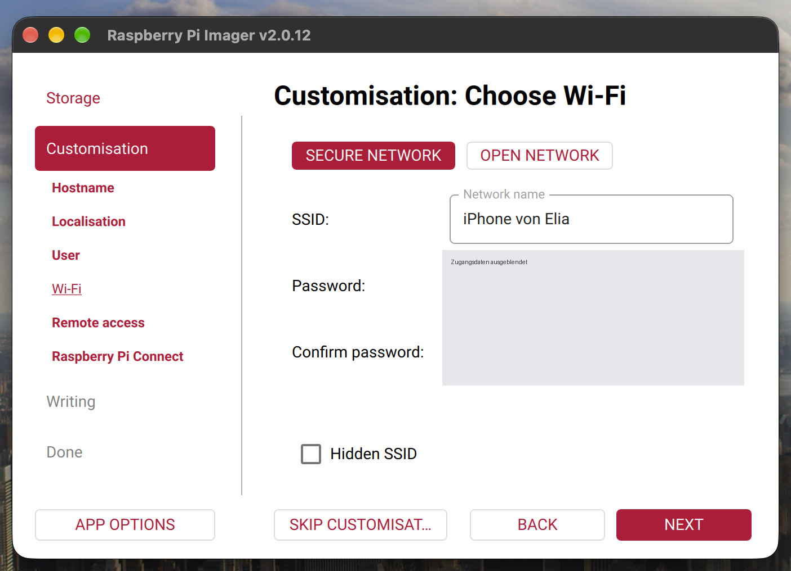

### Step 7 — Enable SSH

Turn on **Enable SSH** and choose **Use password authentication** for the first setup.

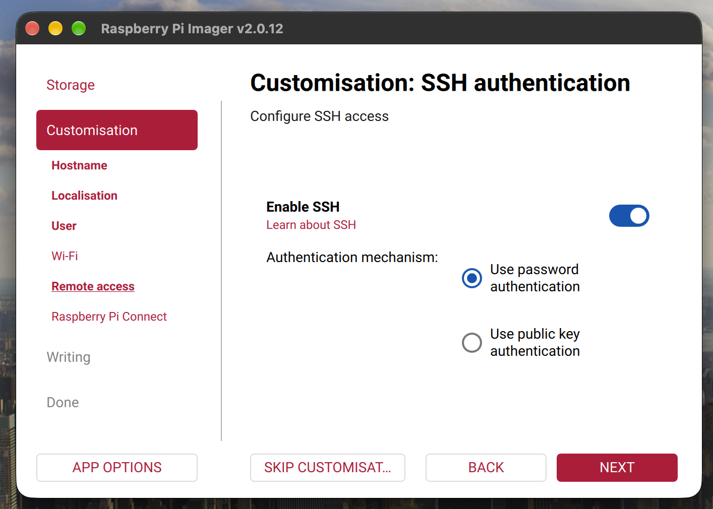

### Step 8 — Optional: Raspberry Pi Connect

Raspberry Pi Connect was enabled in Imager. It requires internet access. For a local network without internet, use SSH instead. Raspberry Pi OS Lite supports remote shell access, not desktop screen sharing.

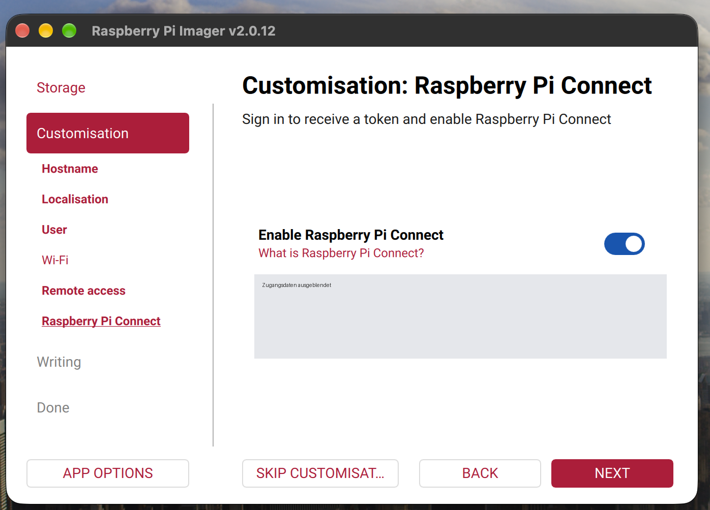

### Step 9 — Write the card

Complete the setup, write the OS to the card, wait for verification, and safely eject the card.

## 4. Start the Pi without a monitor

1. Turn on the iPhone hotspot.
2. Connect your Mac to the same hotspot.
3. Insert the microSD card into the Pi.
4. Connect a suitable power supply and wait a few minutes for the first boot.
5. Open **Terminal** on the Mac.

Connect with SSH:

```bash
ssh parkit-orchestrator@parkit-orchestrator.local
```

On the first connection, check the host key fingerprint against a trusted value before accepting it. Enter the Linux password when asked. The password will not appear while typing.

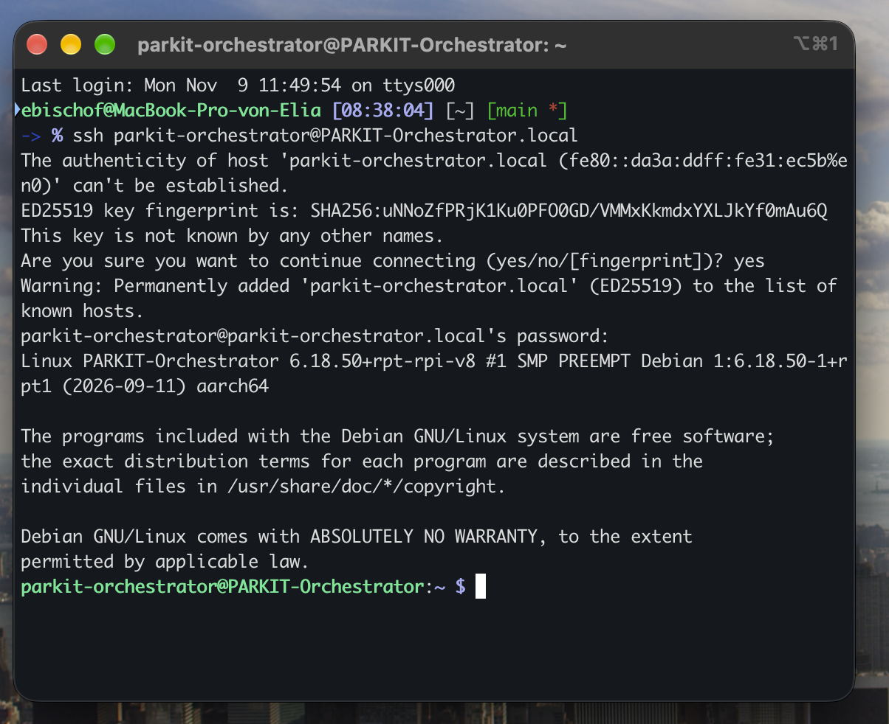

If `.local` does not work, find the Pi's IP address in the hotspot device list and use:

```bash
ssh parkit-orchestrator@<PI_IP_ADDRESS>
```

Some phone hotspots block communication between connected devices. In that case, local SSH may not work even if both devices are connected.

## 5. Change system settings

Once connected by SSH, open the configuration menu:

```bash
sudo raspi-config
```

Use the arrow keys, Tab, and Enter to navigate. You can change system settings, interfaces, and regional settings. Some changes need a reboot.

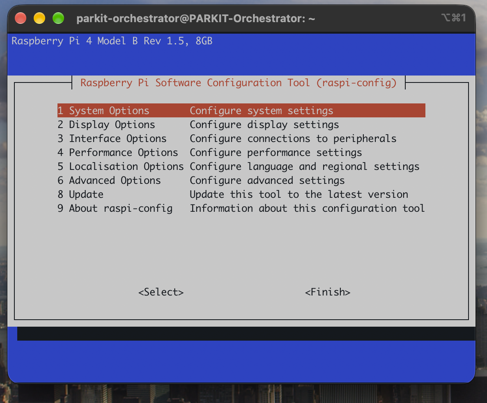

Useful commands:

```bash
hostname                 # Show hostname
hostname -I              # Show local IP addresses
nmcli device wifi list   # List nearby Wi-Fi networks
nmcli connection show    # Show saved connections
sudo reboot              # Restart
sudo shutdown -h now     # Shut down safely
```

**Be careful:** Changing the active Wi-Fi connection may disconnect SSH.

## 6. Check that the Pi works

Run these commands in the SSH terminal:

```bash
cat /etc/os-release       # OS version
uname -m                  # CPU architecture
free -h                   # RAM usage
vcgencmd measure_temp     # CPU temperature
python3 --version         # Python version
cat /proc/device-tree/model  # Actual Pi model
```

Results shown in the setup screenshots:

- Debian GNU/Linux 13 (Trixie), Debian 13.7
- `aarch64` (64-bit ARM)
- About 7.6 GiB RAM total; about 235 MiB used at the time
- Temperature: 37.0°C at the time
- Python 3.13.5

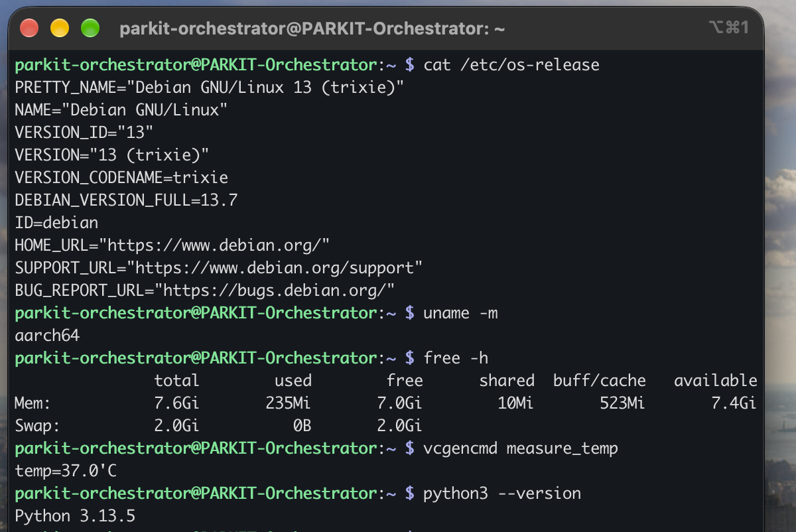

These checks show that the OS runs, SSH works, and Python is available. The screenshots do **not** confirm that a custom Python script has already been run.

## 7. Run your first Python script

Create a project folder:

```bash
mkdir -p ~/projects/hello
cd ~/projects/hello
nano test.py
```

Paste this code:

```python
import time

for i in range(3):
    print(f"PARKIT Orchestrator: test {i + 1}")
    time.sleep(1)

print("Test complete")
```

Save in `nano` with **Ctrl+O**, Enter, then **Ctrl+X**. Run:

```bash
python3 test.py
```

To create a virtual environment for a Python project:

```bash
cd ~/projects/hello
python3 -m venv .venv
source .venv/bin/activate
```

If the `venv` package is missing, it may need to be installed when internet or a package source is available.

## 8. Copy code from your Mac to the Pi

Run this on the **Mac**, not inside the SSH session:

```bash
scp ./test.py parkit-orchestrator@parkit-orchestrator.local:~/projects/hello/
```

Then connect to the Pi and run the file:

```bash
ssh parkit-orchestrator@parkit-orchestrator.local
cd ~/projects/hello
python3 test.py
```

For larger projects, use Git when network access and Git are available. Do not put passwords or tokens in the repository.

## 9. Stop or restart the Pi

```bash
sudo reboot            # Restart the Pi
sudo shutdown -h now   # Shut down safely
```

Wait until shutdown is complete before unplugging the power.

## 10. Troubleshooting

| Problem | What to check |
|---|---|
| `Could not resolve hostname` | Check hotspot connection, hostname, or use the Pi's IP address. |
| `Connection timed out` | Check power, Wi-Fi, and whether the hotspot allows devices to talk to each other. |
| `Connection refused` | Check whether SSH was enabled in Imager. |
| `Permission denied` | Check username and password; Linux passwords are case-sensitive. |
| SSH stops after changing Wi-Fi | Reconnect using the new network and IP address. |
| Python package install fails | Check internet/package availability; use a virtual environment for project dependencies. |

## 11. Security and team handover

- Never commit passwords, Wi-Fi passwords, SSH private keys, or Connect tokens to GitHub.
- Share credentials through the team password manager.
- The original screenshots showed secrets. **Rotate the exposed Linux password, hotspot password, and Connect token** before sharing the system widely.
- The images in this folder use redacted versions of the screenshots.
- For regular team access, consider individual Linux accounts and SSH keys instead of sharing one password.
- Keep a record of the device model, network, power supply, and installed project dependencies.

---

**Documentation date:** 10 November 2026  
**Project:** PARKIT Orchestrator
