# Panel mockups

Extracted from the original composite JPEG; PNG export does not restore source resolution. Layout reuse below is a proposal for review, not a change to the use-case specification.

UC-13 is a reservation ending soon; UC-14 is the next reservation; UC-15 to UC-17 cover guest or third-party reservations.

## DISP-UC-01

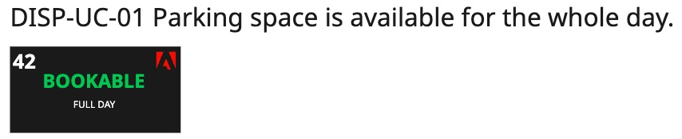

## DISP-UC-02

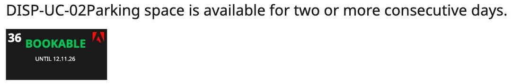

## DISP-UC-03

## DISP-UC-04

## DISP-UC-05

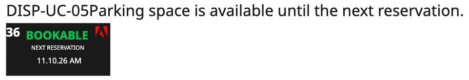

## DISP-UC-06

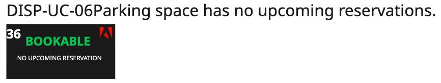

## DISP-UC-07

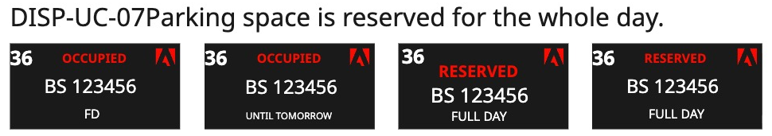

## DISP-UC-08

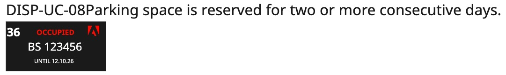

## DISP-UC-09

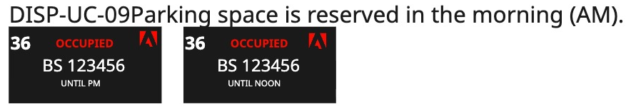

## DISP-UC-10

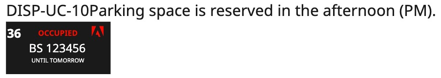

## DISP-UC-11

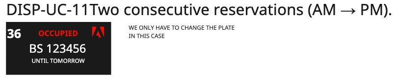

## DISP-UC-12

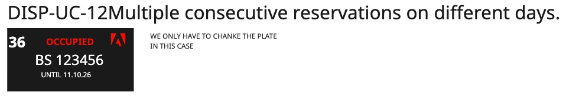

## DISP-UC-13

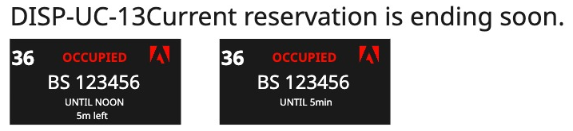

## DISP-UC-14

UC-11/12 as a starting point; NEXT date and time still need explicit design review.

## DISP-UC-15

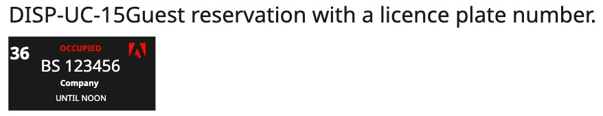

## DISP-UC-16

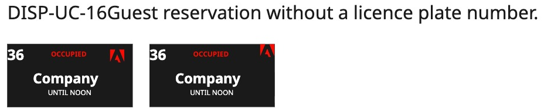

## DISP-UC-17

UC-07 or UC-15 depending on reservation details.

## DISP-UC-18

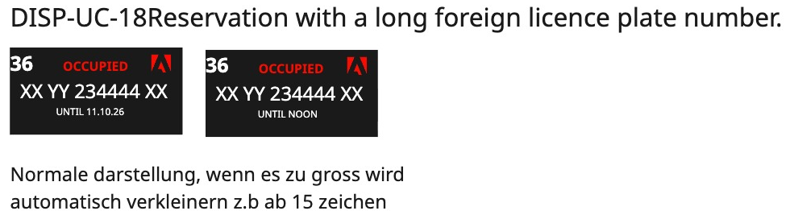

## DISP-UC-19

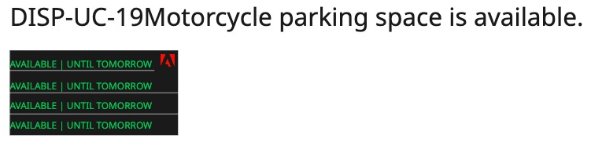

## DISP-UC-20

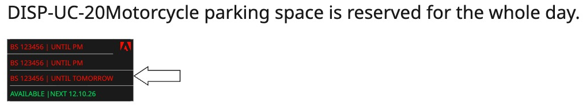

## DISP-UC-21

## DISP-UC-22

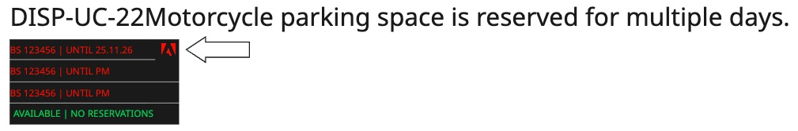

## DISP-UC-23

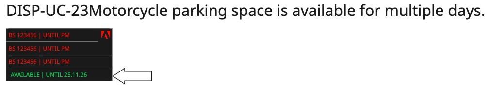

## DISP-UC-24

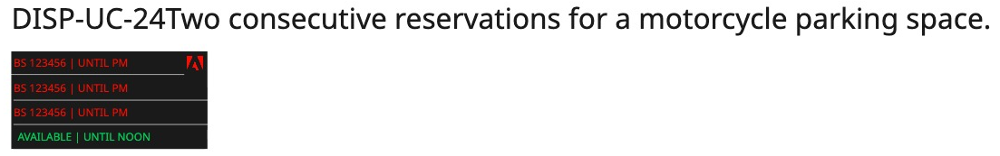

## DISP-UC-25

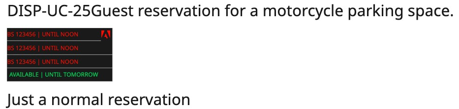

## DISP-UC-26

UC-01–06 or UC-19–25 after recalculation.

## DISP-UC-27

UC-07–12 or UC-19–25 with updated times.

## DISP-UC-28

UC-07–12 or UC-15 with updated plate.

## DISP-UC-29

Recalculate both affected panels using the applicable layouts.

## DISP-UC-30

UC-07–12 or UC-20–24.

## DISP-UC-31

UC-01–06 or UC-19–25, or next reservation layout.

## DISP-UC-32

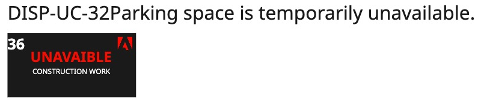

## DISP-UC-33

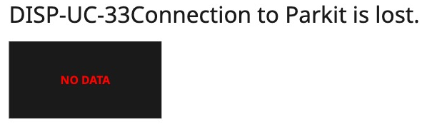

## DISP-UC-34

Same layout as DISP-UC-33 (NO DATA); suppress stale reservation information.

## DISP-UC-35

Same layout as DISP-UC-33 (NO DATA); suppress invalid reservation information.

## DISP-UC-36

No dedicated mockup yet; holiday behaviour and layout require review.
